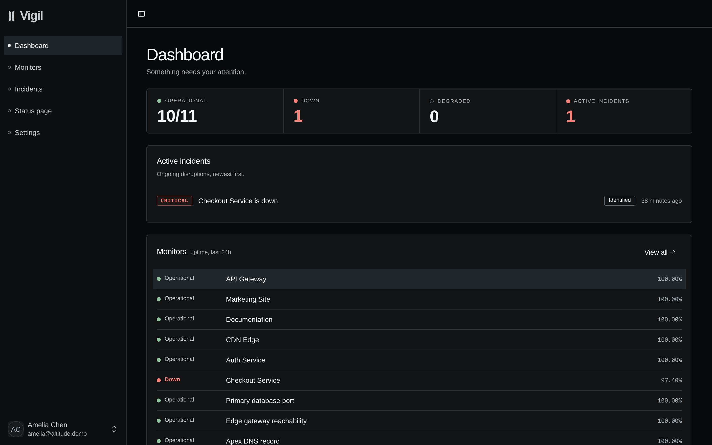
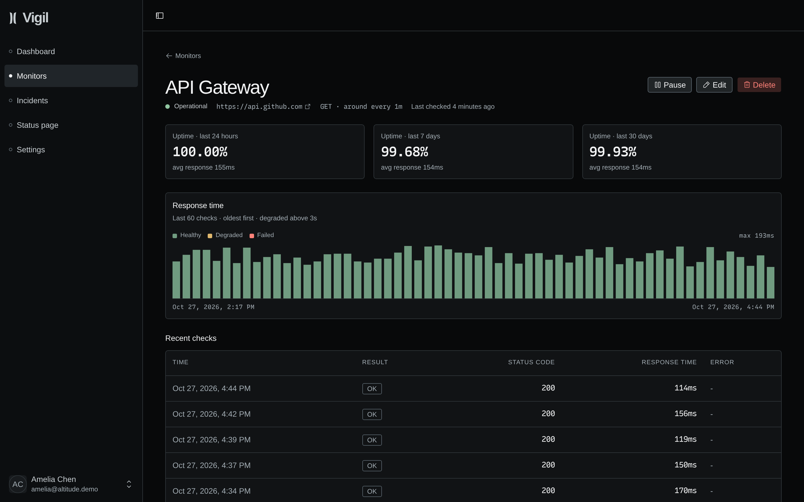
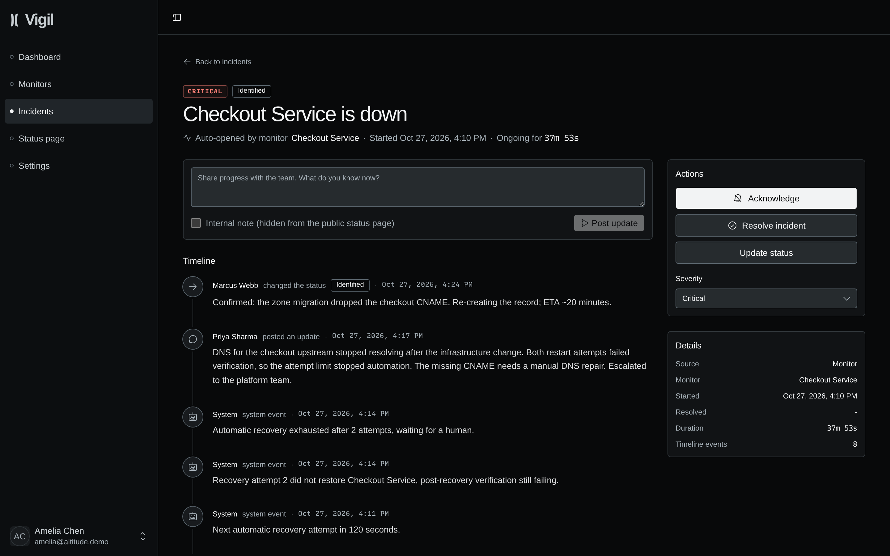
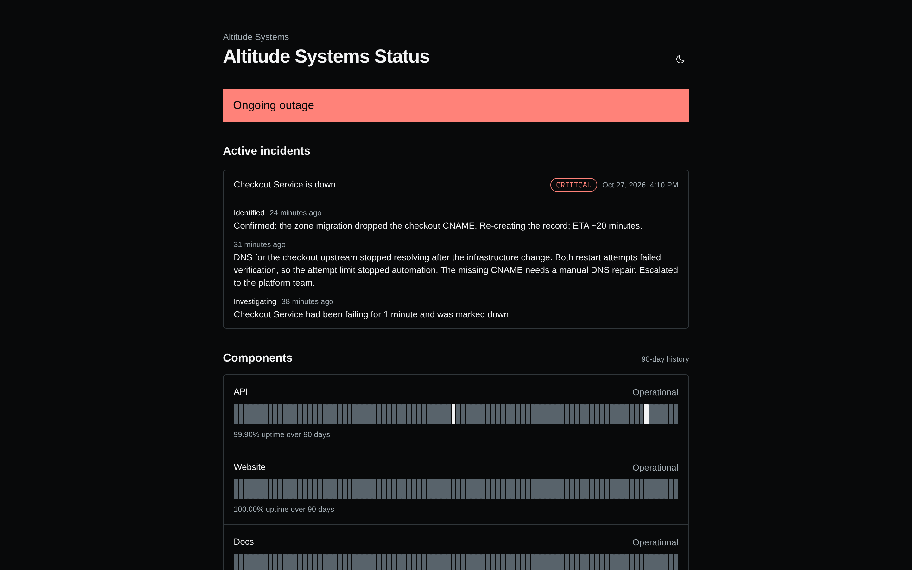
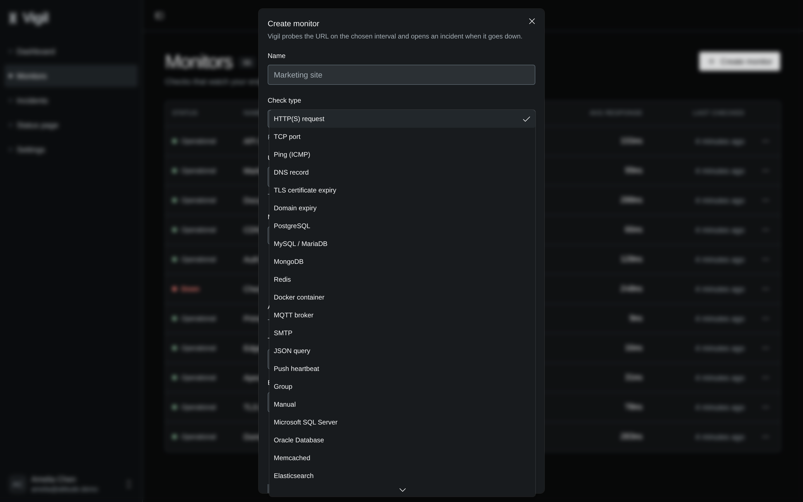
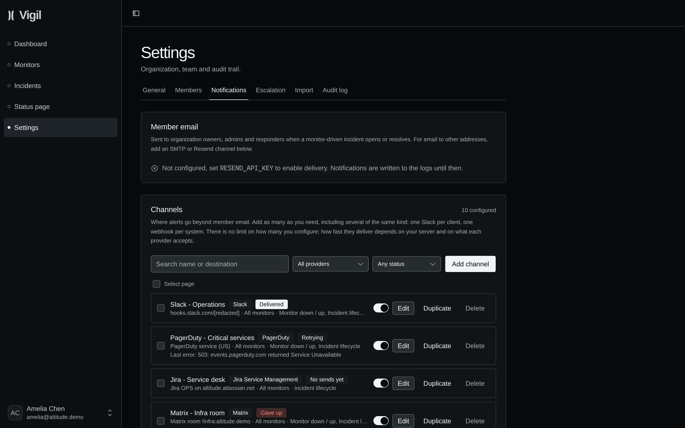
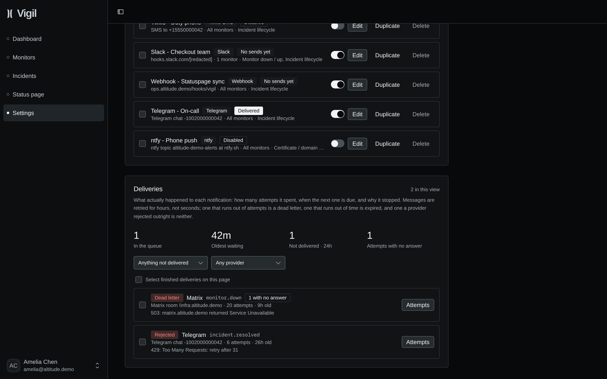
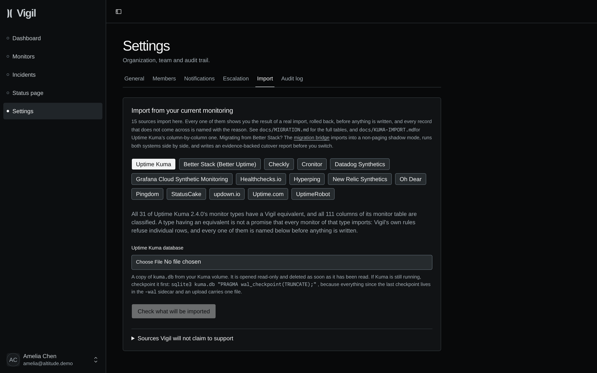
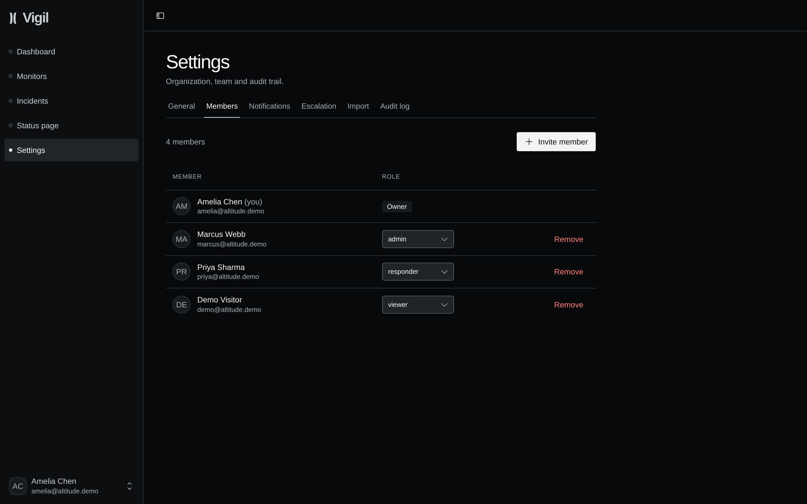
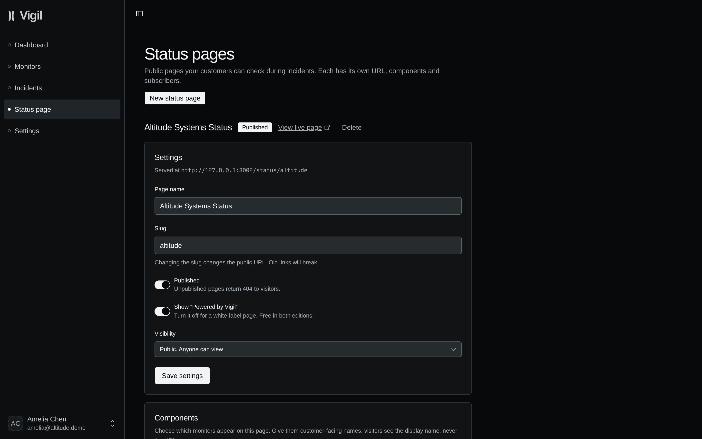

<picture>
  <source media="(prefers-color-scheme: dark)" srcset="docs/brand/vigil-mark.svg">
  
</picture>

# Vigil Core

Self-hosted uptime monitoring, incidents and status pages. Two processes
and one Postgres. No Redis, no queue broker, no agents.

[Interactive tour](https://vigil-uptime.com/demo/) ·
[Docs](https://vigil-uptime.com/docs/)

[](LICENSE)
[](https://github.com/sikurdev/vigil-core/releases/latest)
[](https://github.com/sikurdev/vigil-core/pkgs/container/vigil-core-web)
[](https://github.com/sikurdev/vigil-core/stargazers)
[](docs/DEPLOYMENT.md)

<a href="https://zenith.hosting/host/vigil-core"></a>

## Try it in 2 minutes

Published images and Postgres. No clone, no build. Listens on
`127.0.0.1:3000`.

For production, use [`./vigilctl install`](#quick-start). It generates
secrets, builds from this checkout, and does backup, update and
rollback. This path does not.

```bash
mkdir vigil && cd vigil
curl -fsSL -o docker-compose.yml \
  https://raw.githubusercontent.com/sikurdev/vigil-core/main/deploy/docker-compose.yml
printf 'BETTER_AUTH_SECRET=%s\n' "$(openssl rand -base64 32)" > .env
docker compose up -d
```

Open <http://localhost:3000> once `web` is healthy (`docker compose ps`)
and create the owner account. The worker is already running.
`docker compose down` stops the stack. `docker compose down -v` deletes
the database volume.

[`deploy/docker-compose.yml`](deploy/docker-compose.yml) pulls
`ghcr.io/sikurdev/vigil-core-web` and `ghcr.io/sikurdev/vigil-core-worker`
at tag `1.30.0`. Set `VIGIL_VERSION` to another published tag, including
`latest`. From a checkout, write `.env` as `deploy/.env` and run
`docker compose -f deploy/docker-compose.yml up -d`. Compose reads
`.env` from the directory the compose file is in.

Monitors refuse private and loopback addresses unless
`ALLOW_PRIVATE_MONITOR_TARGETS=true` is set in that `.env`.

<!--
TODO: add a short GIF of a check failing, the incident it opens, and the
status page updating. Do not reference an image until that file is in
the repository. The stills below are the screenshots that exist today.
-->

|                                                                   |                                                              |
| ----------------------------------------------------------------- | ------------------------------------------------------------ |
|                       |        |
|           |       |
|     |  |
|  |       |
|                          |        |

## What it does

- **Forty check types**, in a registry. HTTP(S), JSON query, a real
  browser engine, TCP/port, UDP, ping (ICMP), DNS records,
  TLS-certificate expiry, domain-registration expiry. PostgreSQL,
  MySQL / MariaDB, MongoDB, Redis, SQL Server, Oracle, Elasticsearch,
  Memcached. MQTT, Kafka, RabbitMQ. SSH, FTP, IMAP, SMTP, LDAP, NTP,
  SNMP, RADIUS, gRPC, WebSocket, SIP, Docker containers, systemd
  services, Tailscale, Globalping, Steam, GameDig. Push heartbeats,
  groups derived from other monitors, and a hand-set status dial
  nothing. A new type is five files and no dispatch edit. Everything
  but PostgreSQL speaks the wire protocol directly. Twenty-six types
  arrived since 1.12.0, and `package.json` is unchanged.
- **Assertions**: expected status, response-time thresholds, body
  contains or does not contain a keyword, DNS record values, days left
  on a certificate. A 200 that serves an error page is caught.
- **Scheduling.** The interval you set is a baseline. A suspicious
  monitor is probed more often. A steady one backs off. Minimum is
  two seconds, or 500 ms for HTTP, JSON and TCP on the high-frequency
  plane.
- **Incidents** open and resolve in the check loop. The failure window
  is in seconds, not a count of checks. Severity, a lifecycle, an
  append-only timeline, internal-only notes, a markdown postmortem.
- **Status pages**: as many as you want. Each has its own URL,
  components, 90-day uptime bars and incident history. Public, private
  or password-protected, with double-opt-in email subscribers.
- **Roles**: owner, admin, responder, viewer. Viewers are read-only on
  the server, not by hiding a button.
- **Audit log**: every mutation records actor, target and metadata.
  There is a page for it.
- **Alerts**: member email plus 25 native provider types, one channel
  editor, one delivery pipeline, no cap on channels. Credentials are
  stored encrypted. Deliveries go through a transactional outbox with
  retries and per-channel rate limits. Delivery history shows provider,
  event, attempts, final status and a redacted error. Signed webhooks
  keep their HMAC-SHA-256 signature and versioned payload. Anything
  else goes through an Apprise server you run.

No license key, no telemetry, no expiry. No cap on monitors, users,
organizations' members or retention.

## Quick start

This is the production install. `vigilctl` generates the secrets, builds
the images from this checkout, runs the migrations, and waits until the app and
the worker answer, then prints the endpoint. It needs Docker and bash.
`update` and `rollback` apply to this install, not to the prebuilt
images above.

```bash
git clone https://github.com/sikurdev/vigil-core.git
cd vigil-core
./vigilctl install
```

`./vigilctl doctor` reports what is wrong and changes nothing. `backup`
and `restore` use the dump path and its safety checks.
`update --to <ref>` and `rollback` move the checkout and the database
together. Reference: [docs/VIGILCTL.md](docs/VIGILCTL.md). Bare metal
and the first monitor: [QUICK_START.md](QUICK_START.md).

## Container images

```bash
docker pull ghcr.io/sikurdev/vigil-core-web:1.30.0
docker pull ghcr.io/sikurdev/vigil-core-worker:1.30.0
```

The try-it file defaults to tag `1.30.0`. Set `VIGIL_VERSION` to
another published tag, including `latest`.

[`deploy/docker-compose.yml`](deploy/docker-compose.yml) is that file.
For Easypanel, deploy
[`docker-compose.easypanel.yml`](docker-compose.easypanel.yml), set its
required environment variables, and route the domain to `web` on port
3000.

## Limitations

- **Checks run from one host.** A monitor going down means this Vigil
  host could not reach it. The failure window filters short blips. This
  is not multi-region confirmation. Run Vigil outside the blast radius
  of what it watches.
- **25 native provider types, unlimited channels, plus member email**:
  Slack, Discord, Microsoft Teams, Telegram, Google Chat, Mattermost,
  Rocket.Chat, Matrix, Zulip, LINE, PagerDuty, Jira Service Management,
  Pushover, Gotify, ntfy, Pushbullet, Bark, Web Push, Home Assistant,
  Twilio SMS, Twilio WhatsApp, SMTP, Resend, signed webhooks and Amazon
  SNS. Uptime Kuma 2.4.0 has 94 notification providers. A service on
  that list and not on this one has no native provider here. Point
  Vigil at an Apprise server you run and it forwards to whatever that
  server is configured for. That is a bridge, not an integration: those
  services are not implemented, pinned or tested here, and none of them
  is counted in the 25.
- **Kuma import.** Each of Kuma's 31 selectable monitor types has an
  equivalent here. That does not mean every monitor of that type
  imports. Vigil still refuses what it would refuse from the form. Tags
  and maintenance windows have no counterpart in Core and are reported,
  not imported. Notification providers do have a counterpart, but no
  credential is read from a Kuma database. Those are reported and set
  up again under Settings. [docs/KUMA-IMPORT.md](docs/KUMA-IMPORT.md)
  states both numbers and lists every refusal.
- **No maintenance windows.** A planned deploy alerts like an outage.
  Pause the monitors, or accept the alerts.
- **One organization per install.** One team. Not several clients side
  by side.

## How this repository is produced

Vigil Core is generated from the commercial tree by deleting every file
and statement marked `@edition:ee`. That script is a required job on
every push and pull request there. It strips the tree, then lints,
typechecks, tests, builds, migrates an empty Postgres and serves HTTP.
If Core falls behind, that build is red.

Both editions are cut from the same commit and use the same version.
If this repository's version trails the commercial one, that job is
broken.

History is not rewritten here. Releases are not force-pushed.

## Contributing

[CONTRIBUTING.md](CONTRIBUTING.md). No CLA, no copyright assignment. It
says what Apache-2.0 lets the maintainer do with your contribution.
Security issues go to [SECURITY.md](SECURITY.md), not the issue tracker.

## Commercial edition

[Vigil](https://vigil-uptime.com) is the same monitor plus the items
below. Uptime Kuma has none of them, except maintenance windows.

- **Multiple organizations.** Each has its own status pages and cannot
  see the others.
- **On-call.** Schedules and escalation ladders. Acknowledgement stops
  the ladder.
- **SMS and voice** through your own Twilio account.
- **Automatic recovery.** Verify the failure, call a restart hook you
  own with a signed payload, verify it came back, and page a human only
  if it did not.
- **Remote probes.** Agents you run on your own machines, in the regions
  you choose. A quorum decides. Vigil ships the agent and hosts nothing.
- **Maintenance windows and routing.** Windows for planned work, and one
  routing rule for who is notified, assigned to the workspace, a service
  or one monitor. Kuma has maintenance windows. Core does not.
- **Journeys.** `synthetic-api` and `synthetic-browser` are the only
  check types the paid edition adds. They need a browser container you
  deploy, and their own tables. Every protocol check type ships in both
  editions, and will stay in both.
- **SLOs.** Error budgets and burn-rate alerting.
- **Runbooks.** Typed remediation with immutable published versions,
  approvals and resource leases. Operations tasks are the same engine
  for work a runbook cannot do.
- **Fleet.** Whether monitoring is running, how far behind the scheduler
  is, and what each worker replica's last tick did.

Every protocol check type, the scheduler, the ledger, the audit page,
subscribers and password-protected pages are in Core, free, and stay
there.
[What we commit to, in writing](https://vigil-uptime.com/open-source.html).

## License

[Apache-2.0](LICENSE). Run it, modify it, keep your changes private, run
it for clients, sell it. No copyleft. Vigil Core was AGPL-3.0 through
1.0.1. Copies obtained under that license remain available under it.
